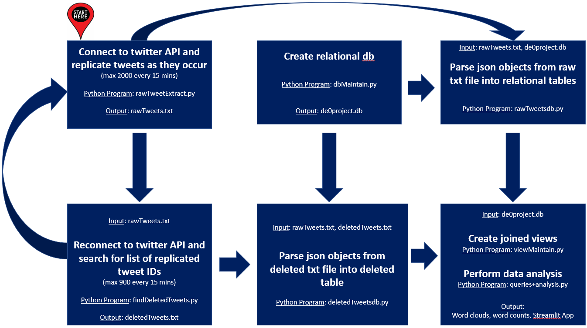
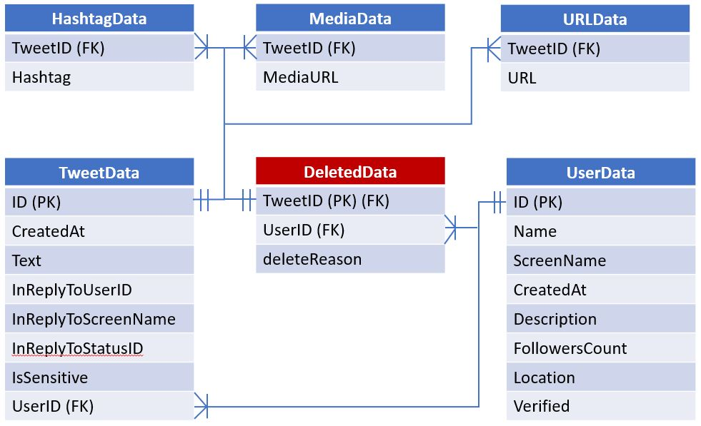

# theGRÆY: What Did Twitter Actually Remove?

An independent, end-to-end data project that collected **64 million tweets** from the public Twitter API between late 2021 and early 2023, re-checked each one later to see whether it had disappeared, and recorded *why* Twitter said it was gone. The findings are written up at **[inthegraey.com](https://inthegraey.com/)**.

The question was simple: when Twitter removes content for breaking its rules, what is it removing, and is the enforcement consistent with the published rules? Twitter published the rules and never published the enforcement data, so this project built its own.

> **Content warning.** `censoredtweets.txt` contains tweets that Twitter removed for violating its rules. Much of it is hate speech, slurs, and harassment, reproduced verbatim as evidence. It is included as research output and is not endorsed.

> **Status: archived.** This repo is a record of finished work. Collection used Twitter API v1.1 endpoints that X has since retired and put behind paid tiers, so the collection scripts will not run against today's API. The code is kept as it ran, with only placeholder paths and dependency versions updated.

## Findings

- **64,163,912** tweets collected into a local SQLite database.
- **1,153** tweets confirmed removed with Twitter's own reason code: *"This Tweet is no longer available because it violated the Twitter Rules."* Many more came back as suspended accounts, protected accounts, or author deletions, and those were tracked separately so they did not inflate the count.
- A manual, tweet-by-tweet review found that **three of the top four removal reasons were forms of hate speech**. The early concern about bias in enforcement did not hold up in this data.
- Timing matters. Re-checking quickly catches the specific rule violation. Waiting longer usually means the account is suspended, which hides which tweet triggered the action.
- A follow-up machine learning study (2024) tried to predict removal from tweet text alone. The best model reached **93% accuracy and 84% precision** on removed tweets, with **39% recall**. That is a useful signal and too noisy to stand alone, which matches what the manual review found.

## How it works



Two loops run against the API. One replicates new tweets as they are posted. The other walks back through stored tweet IDs and asks Twitter for each one again. Any tweet that comes back as an error is saved with the exact error message, which is Twitter's stated reason for its absence. Both outputs are parsed into a relational database, joined into views, and queried for analysis.

| Step | Script | What it does |
|---|---|---|
| 1. Collect | [`rawTweetExtract.py`](rawTweetExtract.py) | Streams English tweets from the v1.1 search endpoint (about 2,000 per 15 minute rate window) and appends the raw JSON to `rawTweets.txt`. |
| 2. Schema | [`dbMaintain.py`](dbMaintain.py) | Creates `de0project.db` with user, tweet, hashtag, media, URL, and deleted-tweet tables. |
| 3. Load | [`rawTweetsdb.py`](rawTweetsdb.py) | Parses raw tweet JSON into the relational tables. |
| 4. Re-check | [`findDeletedTweets.py`](findDeletedTweets.py) | Looks up each stored tweet ID again (about 900 per window), backs off on rate limits, and logs every missing tweet with its error reason. Built to split the ID list across several API accounts so collaborators could run it in parallel. |
| 5. Load removals | [`deletedTweetsdb.py`](deletedTweetsdb.py) | Loads the missing tweets and reason codes into `deletedData`. |
| 6. Views | [`viewMaintain.py`](viewMaintain.py) | Builds the `deleteView` and `HashTags` views that join tweets, users, and removal reasons. |
| 7. Analysis | [`queries+analysis.py`](queries+analysis.py) | Counts by reason code, exports confirmed rule violations, and produces the word clouds and word counts used in the blog. |
| 8. Publish | [`streamlitWork.py`](streamlitWork.py) | A small Streamlit app that displayed the confirmed removals publicly. Output is in [`censoredtweets.txt`](censoredtweets.txt). The hosted app is retired. |

### Data model



## Machine learning study

Two notebooks extend the project into a graduate data science final project on predicting removal from text.

- [`db_to_csv.ipynb`](db_to_csv.ipynb) builds the modeling set from the database: all 1,153 confirmed removals plus a random sample of tweets that stayed up, labeled 1 (removed) or 0 (still live).
- [`predictions.ipynb`](predictions.ipynb) vectorizes the text two ways (spaCy embeddings and scikit-learn TF-IDF) and compares four approaches on 11,153 tweets.

| Model | Features | Accuracy | Removed-class precision | Removed-class recall |
|---|---|---|---|---|
| Custom KNN, cosine similarity (k=10) | spaCy | 0.90 | | |
| Custom KNN, cosine similarity (k=10) | TF-IDF | 0.93 | | |
| scikit-learn KNN classifier | spaCy | 0.90 | 0.49 | 0.16 |
| scikit-learn KNN classifier | TF-IDF | **0.93** | **0.84** | **0.39** |
| Random forest, 5-fold cross-validation | spaCy | 0.90 | | |
| K-means clustering (k=3) | TF-IDF | no cluster separated removed tweets | | |

About 90% of the modeling set is tweets that stayed up, so a model that always guesses "not removed" scores near 0.90. Precision and recall on the removed class are the numbers that matter. TF-IDF with a KNN classifier was the strongest option, and its true positives skewed toward threats and slurs. The notebook walks through PCA, overfitting checks across values of k, and a qualitative read of false positives and false negatives.

## Write-ups

1. [What is Græy?](https://inthegraey.com/what-is-gr%C3%A6y-cdfc553d5556) (April 2022): why independent transparency into platform algorithms matters.
2. [My Attempt to Demystify Twitter Censorship](https://inthegraey.com/my-attempt-to-demystify-twitter-censorship-243bc8a404c1) (April 2022): the method and first results.
3. [An Update on Censored Tweets](https://inthegraey.com/an-update-on-censored-tweets-35abf8e9ae13) (June 2022): 15 million tweets in, with help from other engineers running the re-check loop.
4. [A Final Report on Twitter Censorship](https://inthegraey.com/a-final-report-on-twitter-censorship-95267a15ea96) (December 2022): the manual review of removal reasons.
5. [Machine Learning to Further Demystify Social Media Censorship](https://inthegraey.com/machine-learning-to-further-demystify-social-media-censorship-4ba7f19cfbfc) (March 2024): the modeling study above.

## Running it

The analysis notebooks need the local database or `projectdf.csv`, which are not included. Both are too large to publish. The notebooks are committed with their outputs so the results can be read without running anything.

To explore the code locally (Python 3.12 or newer):

```bash
python -m venv .venv
source .venv/bin/activate
pip install -r requirements.txt
python -m spacy download en_core_web_sm
```

The collection scripts read API keys from `apiCredentials.json`, which is ignored by git. Copy [`apiCredentials.example.json`](apiCredentials.example.json) to start. Each script has a `<INSERT PATH>` placeholder for the working directory that holds the data files.

## Repository layout

```
.
├── rawTweetExtract.py         collect tweets
├── dbMaintain.py              create the SQLite schema
├── rawTweetsdb.py             load tweets
├── findDeletedTweets.py       re-check stored tweets for removal
├── deletedTweetsdb.py         load removals and reason codes
├── viewMaintain.py            build joined views
├── queries+analysis.py        counts, exports, word clouds
├── streamlitWork.py           public viewer (retired)
├── censoredtweets.txt         confirmed rule-violation removals (content warning)
├── twitterBanned.png          viewer icon
├── db_to_csv.ipynb            build the ML modeling set
├── predictions.ipynb          ML experiments and results
├── docs/                      pipeline diagram and ERD
├── apiCredentials.example.json
└── requirements.txt
```

## License

The code is released under the [MIT License](LICENSE). Tweet text in `censoredtweets.txt` and in the notebook outputs belongs to its original authors and is included for research and commentary.

## Author

Michael DeCero. [deceroai.com](https://deceroai.com) · [GitHub](https://github.com/madecero)
